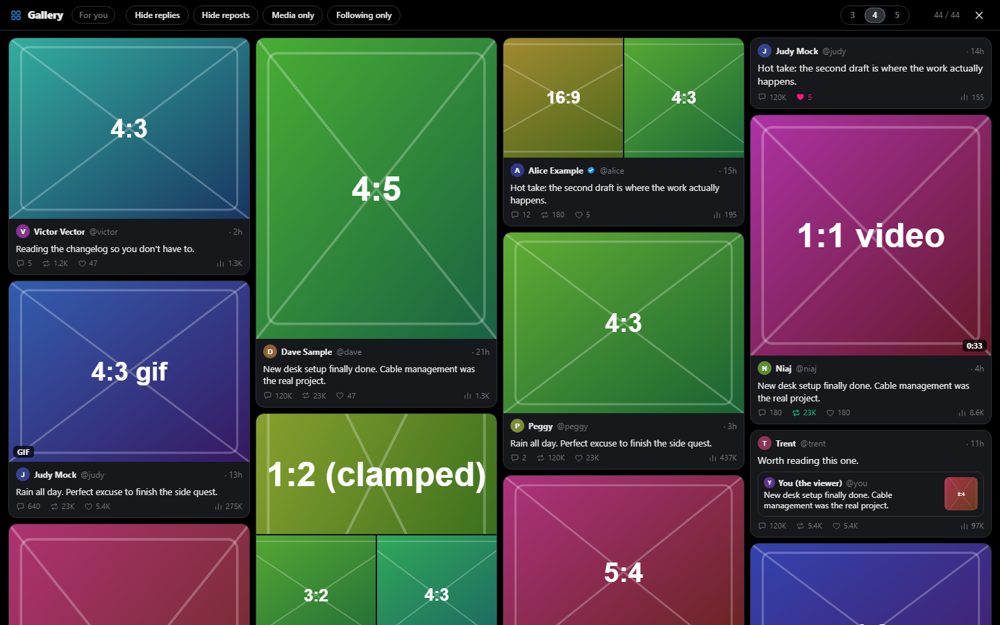
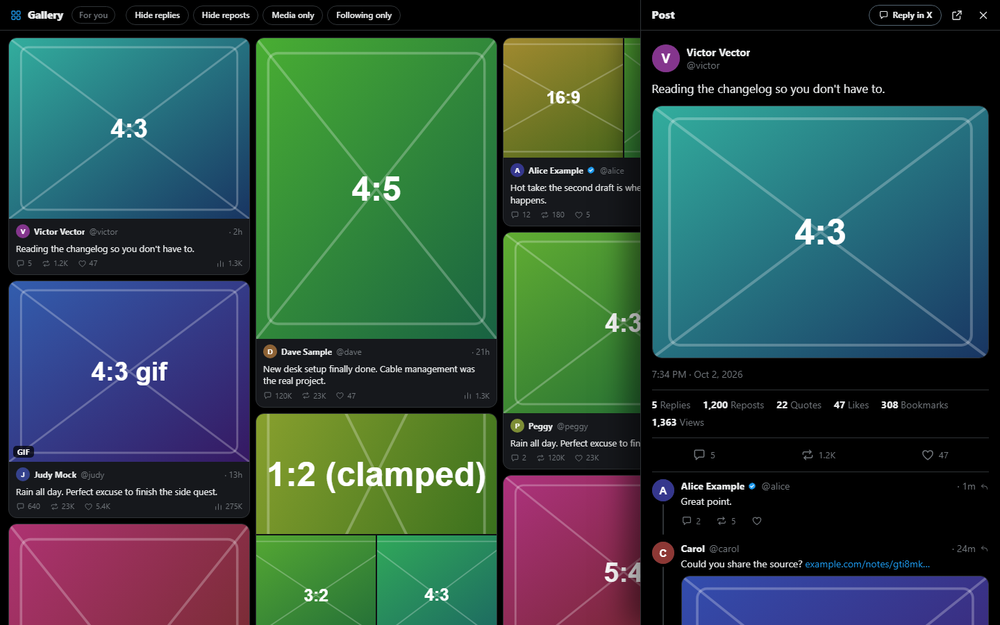

# X Gallery

A browser extension that turns your x.com home timeline into a masonry gallery.
Click a card to read the post and its thread in a side panel, and like or repost
from there.

Screenshots come from the development harness, so the posts and images are
synthetic. On x.com the cards hold the real media from your timeline.

## What it does

- Lays out "For you" and "Following" as a 3, 4 or 5 column masonry grid of
  photos, videos, GIFs and text cards, with the author, time and counts on each.
- Scrolling the grid pages the timeline exactly as scrolling X would.
- Opens any post in a side panel with its ancestors and replies, and the
  lightbox for its media.
- Filters: hide replies, hide reposts, media only, following only.
- Remembers your columns and filters between visits.

## How it works, and what it does not do

The extension never talks to X itself. It reads the timeline responses that
the x.com page already requested, and shows them differently. Scrolling the
gallery scrolls X's own page underneath so X loads the next page. Opening a
post navigates X's router to that post so X loads the thread. Liking and
reposting click X's own buttons in X's DOM.

- It makes no API calls of its own, and sends nothing anywhere. The only data
  it loads is the images and video from X's media CDN that your timeline
  already references.
- Its only permission is `storage`, used to keep your columns and filters in
  the browser's local extension storage. Nothing syncs, nothing leaves the
  browser.
- It does not change X's page or styles. Everything lives in one element with a
  shadow root, and the close button in the toolbar puts X back exactly as it
  was.

Two behaviours to know about before you install:

- **Every video and GIF autoplays, muted,** while it is on screen.
- **Media X marks as sensitive is shown without a blur,** whatever your X
  setting says.

This is an independent project. It is not affiliated with or endorsed by X
Corp.

## Install

There is no store listing. Load it unpacked:

1. Download or clone this repository.
2. Open `brave://extensions` (or `chrome://extensions`).
3. Turn on **Developer mode**.
4. Click **Load unpacked** and pick the repository folder.
5. Open or reload x.com/home.

It needs Brave or Chrome 111 or newer, or any other Chromium browser of that
vintage. It uses nothing Brave disables, so Brave is the primary target.

## Controls

- **Hide replies**, **Hide reposts**, **Media only**, **Following only**:
  toggle chips in the toolbar.
- **3 | 4 | 5**: number of columns.
- **Close (x)** hides the gallery and shows the normal timeline. The
  **Gallery** pill at the bottom of the page brings it back.
- In the side panel: like, repost, open the post on X, or use **Reply in X**.
  Escape closes it. The browser's Back button closes it too.

## When X breaks it

X renames its GraphQL fields and DOM test ids without notice. When that
happens the gallery shows "Waiting for your timeline…" or likes stop working.
Everything that depends on X's shapes is kept in three places on purpose:
response shapes in `src/parse.js`, DOM selectors in `src/native.js`, and the
navigate helper in `src/hook.js`. A fix lands there, with a test fixture for
the new shape.

Bug reports with a note of what X changed are very welcome.

## Development

No build step, no dependencies. Plain JavaScript loaded straight from `src/`.

- `npm test` runs the parser and store tests (Node 20 or newer).
- `dev/harness.html` fakes X's timeline, pagination, thread pages, native
  buttons and history, so the whole UI runs without an X account. Open it from
  disk, or serve the folder and browse to `/dev/harness.html`. Its debug bar
  simulates stalls, dead buttons and navigation edge cases.
- `node dev/make-icons.mjs` regenerates the icons.

`DESIGN.md` holds the data contracts and the reasoning behind the
architecture. `CLAUDE.md` lists the invariants every change must keep.

## License

[MIT](LICENSE).
